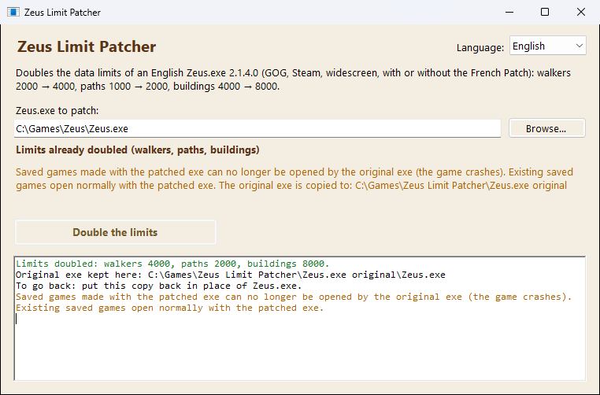

# Zeus Limit Patcher

**Doubles the data limits of *Zeus: Master of Olympus* / *Poseidon* (English Zeus.exe 2.1.4.0): walkers, paths and buildings**
· [Version française plus bas](#français)

Big cities hit fixed limits in the game: walkers stop appearing, workers cannot find a path, no more buildings can be placed. This patcher doubles these limits in your own `Zeus.exe`:

| Limit | Original exe | Patched exe |
|---|---|---|
| Walkers (people and animals moving in the city) | 2000 | 4000 |
| Paths (routes computed for the walkers) | 1000 | 2000 |
| Buildings | 4000 | 8000 |

Nothing else changes: graphics, map size, gameplay and the number of cities on the world map stay the same. No game file is provided.

## Download

Get `Zeus-Limit-Patcher-1.0.zip` from the **[Releases](../../releases)** page: the patcher, instructions in English and French, and the source code.

> Windows may show *"Windows protected your PC"* the first time, because the program is new and unsigned: click **More info**, then **Run anyway**.

## Use

1. Close the game. Copy your saved games somewhere safe (see below).
2. Run `Zeus Limit Patcher.exe`, click **Browse…** and choose the game's `Zeus.exe`. The window shows what it is (normal limits, already doubled, not recognised).
3. Click **Double the limits** and confirm.

The original exe is copied into the `Zeus.exe original` folder next to the patcher. **To go back**, put that copy back in place of `Zeus.exe`.

Command line: `"Zeus Limit Patcher.exe" [--lang fr|en] --info <Zeus.exe> | --patch <Zeus.exe>`

## Saved games

- Existing saved games open normally with the patched exe.
- **Saved games made with the patched exe can no longer be opened by the original exe (the game crashes).** Keep a copy of your saves before you patch if you might go back.

## Supported exes

- English `Zeus.exe` 2.1.4.0 (Zeus with or without Poseidon): GOG, Steam, widescreen builds. Tested on 86 different English 2.1.4.0 exes.
- With **[Zeus - EXE French Patch](https://github.com/Vicinity4813/zeus-exe-french-patch)**, before or after this patch (same result).
- With **[zeus-qol](https://github.com/andrehamon/zeus-qol)** 1.0.0: install zeus-qol first (its installer only accepts the original GOG exe), then run this patcher. To uninstall zeus-qol later, first put back the exe from `Zeus.exe original`.
- The French retail exe is not supported (use the English exe with the French Patch).

## How it works

- The walker, path and building tables are moved into a new, larger section of the exe, and every reference to them in the game's code is updated (17 809 references), along with the related counts and the saved game table.
- The patched exe always gives a new walker the lowest free number, so walker numbers stay as low as in the original game.
- Every patch is checked before anything is written: undoing it must give back the original exe byte for byte, otherwise nothing is changed.
- Tested in game: cities with more than 4000 buildings, paths no longer saturated, zeus-qol zoom and resolution changes. A city with more than 2000 walkers alive at the same time has not been seen yet (the limit of 4000 is in place).
- Two other tables of 2000 entries whose role is unknown are not enlarged; they were never full in the cities measured.
- The program never connects to the Internet. It only writes the chosen `Zeus.exe` and the `Zeus.exe original` folder.

## Building

Run `build.cmd`: it uses the C# compiler that ships with Windows (.NET Framework 4) and produces `dist\Zeus Limit Patcher.exe` and the development tools (`PatchCli`, `Refs`, `SavCli`, `LowestTest`, `Garde`). `tools\make_release.ps1` builds the release zip.

## Credits and license

- Code: MIT License, see [LICENSE](LICENSE).
- `src/ZeusPak.cs` (used by the saved game tool `SavCli`, not by the patcher) is adapted from **zeus_mapper** by zawapl (Jakub Zawadzki), MIT License, see [LICENSE-zeus_mapper.txt](LICENSE-zeus_mapper.txt).
- Thanks to **JackFuste** for the widescreen exes the patch was developed and tested on.
- Compatibility with **zeus-qol** by andrehamon was tested on its published release; no code from it is used.
- *Zeus: Master of Olympus* / *Poseidon* are games by Impressions Games / Sierra. This is a fan project, not affiliated with them; it includes no game file (only the screenshot of the patcher's window in `docs/images`).

---

## Français

**Double les limites de données de *Le Maître de l'Olympe : Zeus* / *Poséidon* (Zeus.exe anglais 2.1.4.0) : walkers, chemins et bâtiments**

Les grandes cités butent sur des limites fixes du jeu : les walkers n'apparaissent plus, les ouvriers ne trouvent plus de chemin, on ne peut plus poser de bâtiment. Ce patcheur double ces limites dans votre propre `Zeus.exe` :

| Limite | Exe d'origine | Exe patché |
|---|---|---|
| Walkers (personnages et animaux qui circulent dans la cité) | 2000 | 4000 |
| Chemins (trajets calculés pour les walkers) | 1000 | 2000 |
| Bâtiments | 4000 | 8000 |

Rien d'autre ne change : graphismes, taille de la carte, règles du jeu et nombre de cités sur la mappemonde restent les mêmes. Aucun fichier du jeu n'est fourni.

### Téléchargement

`Zeus-Limit-Patcher-1.0.zip` sur la page **[Releases](../../releases)** : le patcheur, les notices en français et en anglais, et le code source.

> Au premier lancement, Windows peut afficher *« Windows a protégé votre ordinateur »*, car le programme est récent et non signé : cliquez sur **Informations complémentaires**, puis **Exécuter quand même**.

### Utilisation

1. Fermez le jeu. Copiez vos sauvegardes en lieu sûr (voir plus bas).
2. Lancez `Zeus Limit Patcher.exe`, cliquez sur **Parcourir…** et choisissez le `Zeus.exe` du jeu. La fenêtre indique ce qu'il est (limites normales, déjà doublées, non reconnu).
3. Cliquez sur **Doubler les limites** et confirmez.

L'exe d'origine est copié dans le dossier `Zeus.exe original`, à côté du patcheur. **Pour revenir en arrière**, remettez cette copie à la place de `Zeus.exe`.

Ligne de commande : `"Zeus Limit Patcher.exe" [--lang fr|en] --info <Zeus.exe> | --patch <Zeus.exe>`

### Sauvegardes

- Les sauvegardes existantes s'ouvrent normalement avec l'exe patché.
- **Les sauvegardes faites avec l'exe patché ne peuvent plus être ouvertes par l'exe d'origine (le jeu plante).** Gardez une copie de vos sauvegardes avant de patcher si vous pensez revenir en arrière.

### Exe pris en charge

- `Zeus.exe` anglais 2.1.4.0 (Zeus avec ou sans Poséidon) : GOG, Steam, exe widescreen. Testé sur 86 exe anglais 2.1.4.0 différents.
- Avec **[Zeus - EXE French Patch](https://github.com/Vicinity4813/zeus-exe-french-patch)**, avant ou après ce patch (même résultat).
- Avec **[zeus-qol](https://github.com/andrehamon/zeus-qol)** 1.0.0 : installez d'abord zeus-qol (son installateur n'accepte que l'exe GOG d'origine), puis lancez ce patcheur. Pour désinstaller zeus-qol plus tard, remettez d'abord l'exe du dossier `Zeus.exe original`.
- L'exe français du commerce n'est pas pris en charge (utilisez l'exe anglais avec le French Patch).

### Fonctionnement

- Les tableaux des walkers, des chemins et des bâtiments sont déplacés dans une nouvelle section de l'exe, plus grande, et chaque référence du code du jeu est corrigée (17 809 références), ainsi que les nombres liés et la table des sauvegardes.
- L'exe patché donne toujours à un nouveau walker le plus petit numéro libre : les numéros restent aussi bas que dans le jeu d'origine.
- Chaque patch est vérifié avant toute écriture : son annulation doit redonner l'exe d'origine octet pour octet, sinon rien n'est modifié.
- Testé en jeu : cités de plus de 4000 bâtiments, chemins qui ne saturent plus, zoom et changements de résolution de zeus-qol. Une cité avec plus de 2000 walkers en même temps n'a pas encore été observée (la limite de 4000 est en place).
- Deux autres tableaux de 2000 cases, au rôle inconnu, ne sont pas agrandis ; ils n'ont jamais été pleins dans les cités mesurées.
- Le programme ne se connecte jamais à Internet. Il n'écrit que le `Zeus.exe` choisi et le dossier `Zeus.exe original`.

### Compilation

Lancez `build.cmd` : il utilise le compilateur C# fourni avec Windows (.NET Framework 4) et produit `dist\Zeus Limit Patcher.exe` et les outils de développement (`PatchCli`, `Refs`, `SavCli`, `LowestTest`, `Garde`). `tools\make_release.ps1` prépare le zip de la release.

### Crédits et licence

- Code : licence MIT, voir [LICENSE](LICENSE).
- `src/ZeusPak.cs` (utilisé par l'outil de sauvegardes `SavCli`, pas par le patcheur) est adapté de **zeus_mapper** de zawapl (Jakub Zawadzki), licence MIT, voir [LICENSE-zeus_mapper.txt](LICENSE-zeus_mapper.txt).
- Merci à **JackFuste** pour les exe widescreen sur lesquels le patch a été mis au point et testé.
- La compatibilité avec **zeus-qol** d'andrehamon a été testée sur sa version publiée ; aucun code n'en est repris.
- *Le Maître de l'Olympe : Zeus* / *Poséidon* sont des jeux d'Impressions Games / Sierra. Projet de fan, sans lien avec eux ; aucun fichier du jeu n'est inclus (seulement la capture de la fenêtre du patcheur dans `docs/images`).
